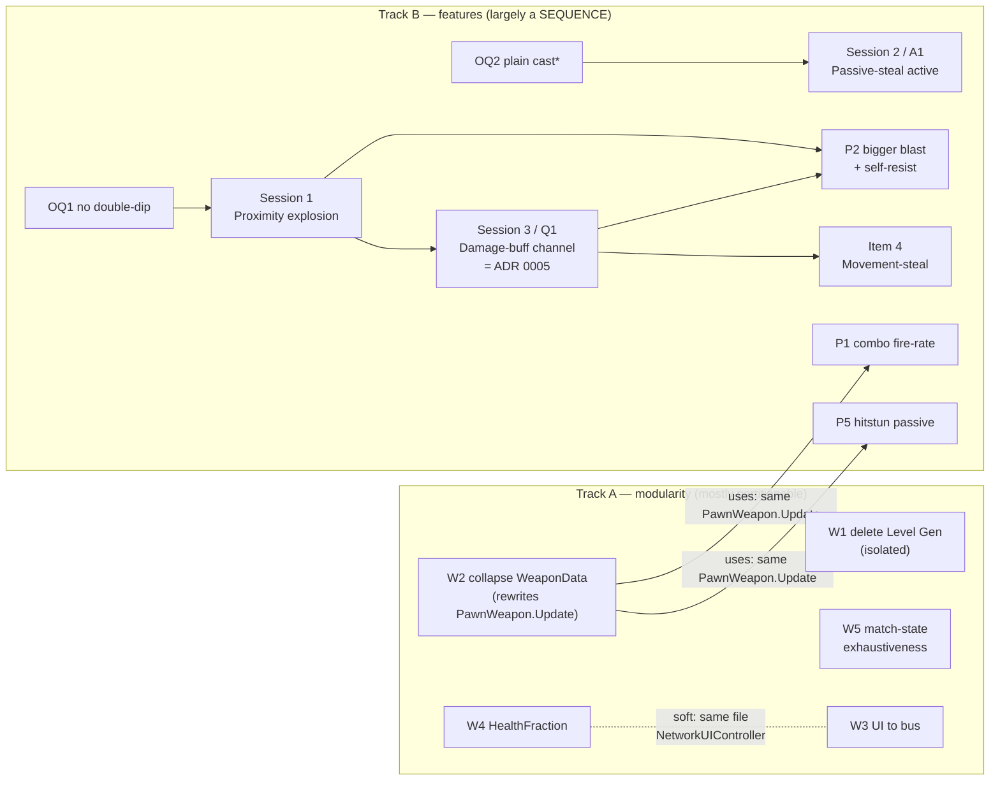
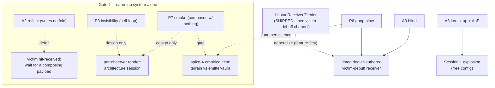

# Master execution DAG — the three plans reconciled

_Drafted 2026-07-15. **The canonical roadmap + build-sequencing hub** — "what's next, in what order" (Tracks A/B/C). It sequences the open items and points into the detail plans; it does **not** restate them. Its companion is [DESIGN.md](../../DESIGN.md), which stays canonical for the two north stars, the **open design questions** (the deferred-decision register this file points to, never copies — per [[design-elegance-root-value]]), and the ADR index. Individual threads are archived here as they ship; the file persists. Corrected against adversarial (design-critic) passes on 2026-07-15 — see the Corrections ledger._

Points into (detail lives there):
- [parnas-modularity-plan.md](parnas-modularity-plan.md) — W1–W5 (modularity leaks, decided, none executed)
- [spike-features-to-real-content.md](spike-features-to-real-content.md) — Sessions 1–4, OQ1–2
- [feature-ledger.md](feature-ledger.md) — the 13-feature batch: per-feature disposition + the original effect×dispatch analysis
- [DESIGN.md](../../DESIGN.md) — open design questions (the "why / deferred decision" for every gate below)

## How this DAG was derived (read before trusting an edge)

The edges below are settled by **which source files / seams each item touches** (`git grep`), **not** by a paper. Parnas's 1972 CACM paper supplies one relevant idea — its *Independent Development* benefit: items that hide **disjoint** design decisions behind stable interfaces can be built concurrently. (The full "uses" partial-ordering-as-schedule is Parnas's *later* work, 1974/79 — the 1972 hierarchy section is a caveat that a module ≠ a call-graph level, not a scheduling tool. Attribution kept honest so this isn't an appeal to authority.)

**The distinction that governs every edge — sequencing ≠ coupling:**
- **Coupling** = when A changes in a *likely* way, B must change too (co-change / ripple). The bad thing. Detected by walking a plausible change through the edge.
- **Sequencing** = B can't *start* until A's interface exists. A partial ordering — desirable layering, says nothing bad about modularity.

Edge count is **not** a modularity metric: a deep chain over stable interfaces has zero coupling; a "fully parallel" plan where everyone edits one god-object is a coupling disaster. Below, each edge is tagged by kind.

## Ratified 2026-07-15 (this session)

- **Map/resource control is NOT excluded.** The essence dropped that exclusion (commit `d50d5a4e`; scope guard pared to the interaction test in `6cda6855`/`49642ec0`). The consolidation's cuts of P6/P7 rested on removed doctrine and are **reversed**. Stale copies synced (`habit-check.sh`, `design-critic.md`, `game-essence` memory).
- **Acquisition** (resolves DESIGN.md's "ability acquisition source" open question): primary objective = fight over **smash-ball pickups** granting **permanent** passives + actives; secondary = **limited-use** active pickups. Two-tier direct-grant, no XP track. → ADR. Caveat: "fight over pickups on the map" carries mild positional pressure — mitigate with a draft/choice framing, not a spawn scramble.
- **Per-observer rendering: adopted as the sanctioned approach** (resolves the open question) — greenlights the architecture **design session** (per-client visibility under server authority). Its two consumers (P3, P7) are non-composing, so the *design* leads; the implementation waits until a feature earns it.
- **Terrain-persistent zones: kept** (P6, P7 stay) — but DESIGN.md's open question wants the terrain-persistence *value* confirmed empirically before the volume is built; **P6's early playtest is that test** (terrain-persistent vs. emitter-attached). The slow itself rides the debuff channel regardless.

## The two tracks

`*` OQ2's *deeper* question is unsettled — see Restored items.

### Track A — modularity (the only genuinely partitionable slice)

All five hide different leaked decisions, so they are independent commits — **except** the two edges the code forces:

| Item | Touches | Parallel? |
|---|---|---|
| **W1** delete Level Generation | `Level Generation/` only | fully isolated — parallel to everything |
| **W4** `HealthFraction` | Health surface, `BotBrain`, `NetworkUIController` | parallel, but **soft edge with W3** (both edit `NetworkUIController`) |
| **W5** match-state exhaustiveness | `Arena.UIFlow.Core` mapping | fully isolated |
| **W3** UI → `NetworkUIEvents` bus | `NetworkUIController`, `PostgameCountdownView` | parallel, soft edge with W4 |
| **W2** collapse `WeaponData` | **rewrites `PawnWeapon.Update` (`:36-48`)** | **NOT parallel to features** — gates P1 (`:59`) and P5 (`:58`), which sit in the same method |

W1/W4/W5/W3 are safe to fan out (low-design, mechanical) — this is the partitionable work the project's ratified understanding permits. W2 is a shell-method rewrite that **two feature items sit inside**, so it lands first.

### Track B — features (one-mind, largely sequential — and that's correct)

Design-laden work; **not** fanned out (per the ratified understanding: subagents search/implement/validate, they don't own design). The ordering:

1. **Wave 0 — ratify tunables:** OQ1 double-dip → **no** (feeds Session 1). OQ2 → **plain cast** for the *mechanics*, but its deeper question (*should the steal BE a hit?*) is **not** foreclosed — see Restored items.
2. **Session 1** (proximity explosion) ∥ **Session 2 / A1** (passive-steal active) — genuinely disjoint seams (own component + prefab-copy vs. own `IUseHandler` use-site). The one real parallel pair in Track B.
3. **W2 → P1, P5** — after W2 lands, P1 (combo fire-rate, `ComboProcessor`) and P5 (hitstun passive) build on the reworked `PawnWeapon.Update`. P5 *ships* gated on the hitstun-feel playtest.
4. **Session 1 → Session 3 / Q1** — the damage-buff channel design session (= **ADR 0005**, not 0004). Runs after Session 1, which gives the per-target `damageMultiplier` slot a live consumer (falloff) = its real *Evidence*. **P2 is NOT its evidence** (P2 is shipped content, not a throwaway spike).
5. **Session 3 → P2** — P2's self-resist is the channel's **first real consumer** (owner-passive-scaled multiplier onto a damage value), so it follows the ADR. P2 also **re-opens Session 1's self-exclusion** (rocket-jump wants self-knockback) — not a clean `SpawnModifier` +2-fields extension. Falsifiable check below.
6. **Session 3 → Item 4** (movement-steal) — LAST; forces the timed-modifier lifetime (Q4) + wire-payload (Q5), both resolved by the ADR.

### Parallel decision track (one-mind, alongside code — blocks *shipping/tuning*, not building)
- **Q1** acquisition source (pickup vs XP) — interview + ADR; grant path is abstract, blocks no wave.
- **Q2** persistence (per-life vs per-game) — interview + ADR + playtest; interacts with respawn.
- **Hitstun feel** — playtest gate; blocks *shipping* P5, adjacent to P1.
- **P4** (extra air-jumps) — **re-pitch around an enemy-facing interaction or cut**; do **not** schedule the additive-`MovementModifier` fold.

## Track C — ability & perception expansion (added 2026-07-15)

Re-adds the five consolidation cuts (**A2** reflect, **A3** pepper, **P3** invisibility, **P6** goop, **P7** smoke) under the ratified decisions.

**Correction (design-critic, verified against code 2026-07-15):** the batch does NOT earn six new systems, and "build the channels first" contradicts our own doctrine (Track B's *"don't unify prematurely"*; shape the abstraction by the hard case). The *"timed dealer-authored victim debuff"* channel that blind and slow both want **already ships as `HitstunReceiver`/`HitstunDealer`** — a `SyncVar<uint>` expiry-tick window, dealer-authored duration, a resistance-modifier fold, each peer evaluating `IsStunned` against its own tick (`HitstunReceiver.cs`). So N1+N2+N6 are **one generalization of a shipped component**, built **feature-first**: goop-slow is the *second* instance of the hitstun pattern, blind the *third*; extract the shared receiver when the third confirms it — not a speculative channel up front.

### Honest rule-of-two accounting (design-critic, verified)

The first draft counted six enabling systems by **double-counting single features** (A3-blind appeared under N1, N2 *and* N6) and by leaning on **P7 as the sole second consumer** of N4, N5 and N6. **Cut P7 and those three drop to N=1** — the batch was at *"one-plus-P7,"* not rule-of-two. Corrected:

| Candidate channel | Real *independent, composing* consumers | Verdict |
|---|---|---|
| **Timed victim-debuff** (generalize shipped `HitstunReceiver`) | P6-slow, A3-blind (+ shipped hitstun, + spike-4 slow) | **Earned** — build feature-first; extract the shared receiver on the 2nd–3rd instance |
| **Victim-side hit-received** | A2, P3, P7 — all *non-composing* (write no upgrade fold); the consolidation already ruled invisibility/smoke the *wrong* first payload, wanting a composing one (heal-on-hit, thorns) | **Defer** until a composing payload arrives |
| **Per-observer rendering** | P3, P7 — both non-composing | **Design session only** — a genuine architecture question (per-client visibility under server authority); decide it, don't *build* it until a feature earns it |
| **Terrain-persistent zone** | P6 (+ P7 only *if* smoke is a zone, not an emitter-attached aura) | **Gate on spike-4** — DESIGN.md's open question demands the empirical terrain-vs-attached test *before* building the volume; likely N=1 |

Precision on the essence test: invisibility/smoke/reflect **pass the scope guard** (they change how the enemy plays, interacting with weapons/perception) but sit at its **shallow end** — they write no upgrade fold, so they don't deepen the *upgrade×upgrade* composition that P1's combo or P2's splash do. That's why they don't earn *new systems* cheaply, even though they're legal.

### Features — honest gates

| Feature | Ships when |
|---|---|
| **A3 knock-up + AoE** | **now** — authored config on Session 1's proximity explosion |
| **P6 goop-slow + A3 blind** | on the timed victim-debuff channel (generalize `HitstunReceiver`, feature-first). Blind = a **local** screen effect on the blinded victim, not per-observer. P6's **zone persistence** is gated on the spike-4 empirical test |
| **P3 invisibility** | after the per-observer-render **design session**; invis-after-hit is a closed self-loop — re-pitch so it composes, or accept it as a shallow-but-legal gadget |
| **P7 smoke** | after per-observer-render session **+** spike-4 zone test; heaviest, composes with nothing, and was the batch's rule-of-two prop |
| **A2 reflect** | reflect-only; defer until a *composing* victim-reaction earns victim-side hit-received — or build it as a one-off projectile-collision check with **no** dispatch adoption |

### System budget — corrected

Post-correction the genuinely-new mechanism is **~1** (generalize a shipped component), plus **up to 2 gated** (per-observer rendering, terrain zone) that don't build until their design session / spike-4 clears — down from *"six systems."* The critic's forced-cut is **A2 and P7**; the ask was to keep P7. **The one open decision:** keep all five *honestly gated* (respects the ask; nothing builds until its gate clears) vs. **trim** to the clean core (P6 + A3, which earn the channel by themselves) vs. cut A2/P7 per the critic. *Recommendation: keep-gated — the gates ARE the honest cost, and no speculative system gets built either way.*

## Does a deep DAG mean the features are too coupled? (the question that prompted this)

**No — and deriving the DAG from evidence (not from Parnas's prose) made it *more* sequential, not less, by exposing two over-claimed "parallel" edges (W2∥features, P2∥Session 3).** That sequentiality is healthy:
- Design work is **one-mind** — parallelizing it is Brooks's law, not throughput.
- The edges are **uses-edges** (P2 rides `SpawnModifier`/`damageMultiplier`, not the explosion internals — change the falloff, P2 is untouched) and **decision-funnels** (Session 3 is the single home for a deferred decision → *anti*-duplication, the opposite of a modularity failure).
- Exactly **one** edge is shared-code coupling: W2/P1/P5 on `PawnWeapon.Update`. It's minor, soft (merge churn, not co-change), and in the **shell**, not a Core.

**The one thing to watch** is not coupling but **concentration**: Session 3 (the channel) is a chokepoint several features route near. The risk is building it *wide* — one broad interface many features share (the over-reveal Parnas warns of in the circular-shift example). Mitigation is already doctrine: build P2/P5 on **narrow existing seams; don't unify prematurely.**

## Corrections ledger (what the adversarial pass changed)
- **W2 is not parallel to the feature track** (was: "Track A fully parallel to Track B"). W2→P1 **and** W2→P5, same `PawnWeapon.Update`. W2 lands first.
- **P2 moves back after Session 3** (was: "P2 doesn't need Session 3"). Its self-resist is the channel's first consumer; building it first would pre-decide the ADR in shipped code.
- **Parnas attribution corrected** — 1972 paper supplies *Independent Development*, not the uses-DAG-as-schedule (later work). DAG derived from touched files.
- **ADR number:** the damage-buff channel session's deliverable is **ADR 0005** (`spike-…-content.md:57` still says 0004, which is taken — cross-peer cosmetics). Fix on that file's next edit.

## Restored items (dropped in the first draft)
- **P4** — re-pitch-or-cut verdict above; do not schedule the additive-movement fold.
- **OQ2 deeper question** — "plain cast" settles the *mechanics*; whether the steal should **BE a hit** (trigger victim reactions, later stack with damage/knockback) is a Parnas module-ownership question owed an interview before Session 2 finalizes.
- **DESIGN.md housekeeping (Lehman paydown — fold into the relevant commits, not a separate wave):** rescope roadmap item 2 to the active variant; delete the stale `agent-*` worktree note; record the 8 cuts (A2–A6, P3, P6, P7) with their one-line reasons so they aren't re-proposed; log the victim-side hit-received gap as an Open-questions observation; delete each source plan when its thread ships.

## Falsifiable checks (each yields a number)
1. **P2-is-the-channel:** count inputs feeding P2's self-resist value — 0 (authored constant) ⇒ not the channel, could precede Session 3; ≥1 (owner passive state) ⇒ it IS the channel, Session 3 first. *(Expected ≥1 — P2 is a passive upgrade.)*
2. **P2-reopens-Session-1:** lines of Session 1 blast code changed to include the instigator's own pawn; >0 ⇒ not an additive extension.
3. **B1 pair really parallel:** intersection of touched source files per pair; non-empty ⇒ serialized. `{W2,P5} ∩ = PawnWeapon.cs` (count 1) ⇒ not parallel.
4. **Not proliferation:** when Session 1 ships, count docs that must be edited to stay consistent — must be **1** (DESIGN.md). If this file still exists and must also change, it has become the fourth drifting artifact it was warned against → delete it.
