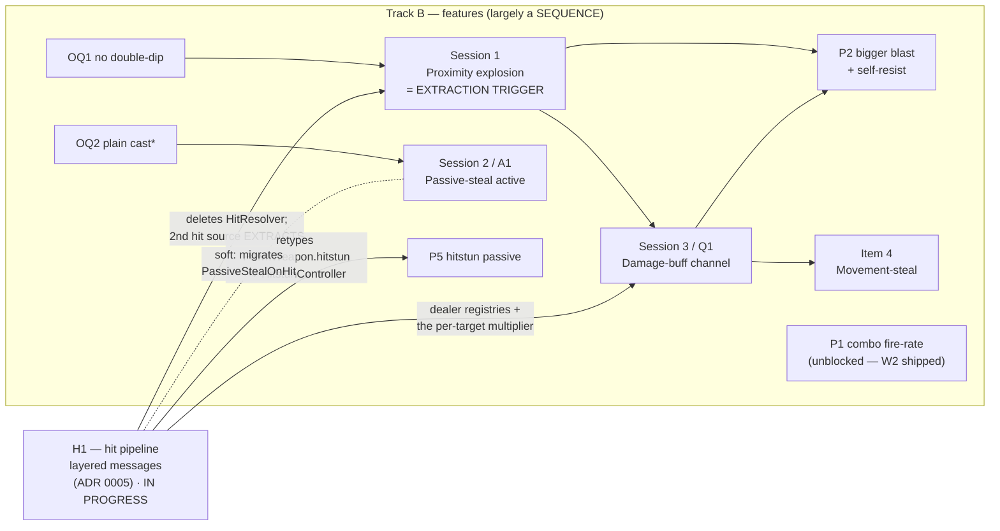
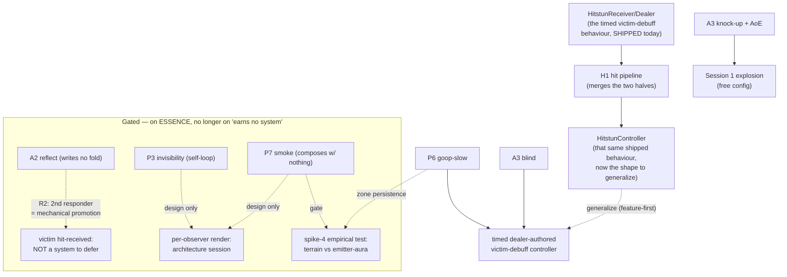

# Master execution DAG — the plans reconciled

_Drafted 2026-07-15; **Track A archived shipped + the hit-pipeline slice (H1) folded in 2026-07-16.** **The canonical roadmap + build-sequencing hub** — "what's next, in what order" (Tracks A/B/C). It sequences the open items and points into the detail plans; it does **not** restate them. Its companion is [DESIGN.md](../../DESIGN.md), which stays canonical for the two north stars, the **open design questions** (the deferred-decision register this file points to, never copies — per [[design-elegance-root-value]]), and the ADR index. Individual threads are archived here as they ship; the file persists. Corrected against adversarial (design-critic) passes on 2026-07-15 — see the Corrections ledger._

Points into (detail lives there):
- [hit-pipeline-layered-messages-plan.md](hit-pipeline-layered-messages-plan.md) — **H1**, the next slice. Owns the layered model's detail (the two idioms, the 3-layer bound, merged controllers). **Delete on ship** — its durable half becomes ADR 0005 + the skills.
- ~~[parnas-modularity-plan.md](parnas-modularity-plan.md) — W1–W5~~ **all five shipped 2026-07-15/16** (see Track A). Delete the plan file.
- [spike-features-to-real-content.md](spike-features-to-real-content.md) — Sessions 1–4, OQ1–2
- [feature-ledger.md](feature-ledger.md) — the 13-feature batch: per-feature disposition + the original effect×dispatch analysis
- [DESIGN.md](../../DESIGN.md) — open design questions (the "why / deferred decision" for every gate below)

**The two idioms govern every hit-adjacent edge below** (from H1's plan; ADR 0005 on ship). Stated once here because they *change the sequencing*, not to restate the plan:
- **Fan-out context** (≥2 unrelated responders, open set) → a pooled **ExecuteEvents message**. Promotion criterion **R2**: a context earns a message at the second unrelated responder — *promote then, not before*.
- **Operation** (one component's capability, many callers) → **direct call**: `GetComponent` + public method, bounded by the **3-layer rule** (context → handlers → operations; operations terminate in data, never discover-and-invoke behaviour).

The scheduling consequence: **"do we need a channel for X?" is no longer an architecture project** — it is R2 arithmetic on the responder count. Several Track C gates below were written before that rule existed and are re-scored under it.

## How this DAG was derived (read before trusting an edge)

The edges below are settled by **which source files / seams each item touches** (`git grep`), **not** by a paper. Parnas's 1972 CACM paper supplies one relevant idea — its *Independent Development* benefit: items that hide **disjoint** design decisions behind stable interfaces can be built concurrently. (The full "uses" partial-ordering-as-schedule is Parnas's *later* work, 1974/79 — the 1972 hierarchy section is a caveat that a module ≠ a call-graph level, not a scheduling tool. Attribution kept honest so this isn't an appeal to authority.)

**The distinction that governs every edge — sequencing ≠ coupling:**
- **Coupling** = when A changes in a *likely* way, B must change too (co-change / ripple). The bad thing. Detected by walking a plausible change through the edge.
- **Sequencing** = B can't *start* until A's interface exists. A partial ordering — desirable layering, says nothing bad about modularity.

Edge count is **not** a modularity metric: a deep chain over stable interfaces has zero coupling; a "fully parallel" plan where everyone edits one god-object is a coupling disaster. Below, each edge is tagged by kind.

## Ratified 2026-07-16 (hit-pipeline consolidation)

- **The layered model is adopted** (the two idioms above) — settled at H1's plan review. It is the successor to "systems never call each other": a sibling's behaviour *may* be called, at **layer 2 only, depth one**. Nothing else in this file's doctrine changes.
- **ADR 0005 goes to the hit pipeline**, not the damage-buff channel. 0005 was *reserved* for the channel on 2026-07-15; 0006 and 0007 were then written past the reservation, leaving 0005 an unclaimed gap that two plans now both name. **Rule (the paydown): an ADR number is claimed when the file is written — take the next free number then. Plans name their ADR by TITLE, never by number.** The damage-buff channel's ADR is now "the damage-buff channel ADR" until it exists. (This is the second time the reservation drifted — the 2026-07-15 ledger already carries one correction for it. Reserving numbers is the defect; the rule deletes the class.)
- **H1 is the trunk of Track B/C, not a side quest.** Its seams (`ServerCollision`, `Damage`, the hitstun/knockback components, the reaction-handler interface) are the seams Session 1, Session 3, P5, P6 and A3-blind all build on. Sequencing it first is *not* preference: those items would otherwise be written against `HitResolver`/`IHitHandler`, which H1 deletes.
- **H1 does not make the explosion-fit question worse — so it is not gated on it.** `HitMessage`'s field list mirrors `HitContext`, which is projectile-shaped (verified). The misfit is *inherited*, not created; Session 1 pays it either way. See falsifiable check 5.

## Ratified 2026-07-15

- **Map/resource control is NOT excluded.** The essence dropped that exclusion (commit `d50d5a4e`; scope guard pared to the interaction test in `6cda6855`/`49642ec0`). The consolidation's cuts of P6/P7 rested on removed doctrine and are **reversed**. Stale copies synced (`habit-check.sh`, `design-critic.md`, `game-essence` memory).
- **Acquisition** (resolves DESIGN.md's "ability acquisition source" open question): primary objective = fight over **smash-ball pickups** granting **permanent** passives + actives; secondary = **limited-use** active pickups. Two-tier direct-grant, no XP track. → ADR. Caveat: "fight over pickups on the map" carries mild positional pressure — mitigate with a draft/choice framing, not a spawn scramble.
- **Per-observer rendering: adopted as the sanctioned approach** (resolves the open question) — greenlights the architecture **design session** (per-client visibility under server authority). Its two consumers (P3, P7) are non-composing, so the *design* leads; the implementation waits until a feature earns it.
- **Terrain-persistent zones: kept** (P6, P7 stay) — but DESIGN.md's open question wants the terrain-persistence *value* confirmed empirically before the volume is built; **P6's early playtest is that test** (terrain-persistent vs. emitter-attached). The slow itself rides the debuff channel regardless.

## The tracks

`*` OQ2's *deeper* question is unsettled — see Restored items. Track A is archived below; Track C is its own section.

### H1 — the hit-pipeline slice (LANDED, and the trunk)

> **Status 2026-07-19:** **LANDED** as **[ADR 0005](../design/0005-hit-pipeline-layered-messages.md)** (Accepted). Runtime proof green on `worktree-hit-pipeline-slice` (EditMode 240/240, PlayMode 55/55 + two new pins). **The design diverged materially during execution — [ADR 0005](../design/0005-hit-pipeline-layered-messages.md) is the authoritative record.** The hand-off table below is reconciled to the shipped seams: dispatch is `HitMessage.Dispatch` (not `ServerCollision.DispatchHit`); `HitMessage` carries **no** per-target multiplier and no `Motion`/`SelfHealth`/`OtherMotion` (all component look-ups now); damage arithmetic is inlined in `DamageController.OnHit` (Core asmdefs deleted); the owner-reaction bridge is `IOwnedObjectContribution` self-cloned at spawn (source-only dispatch); the re-entrancy cycle-guard is **deferred debt** shipped with Session 1's nested dispatch. Falsifiable check 5 (blast leaves ~5 null fields) is **discharged** — those fields were removed. DESIGN.md's per-target-`damageMultiplier` citation for Session 3 is corrected (below + in DESIGN.md).

Detail lives in [hit-pipeline-layered-messages-plan.md](hit-pipeline-layered-messages-plan.md). What this file owns is **why it sequences first** and **what it hands downstream**:

| Hands downstream | To | Edge kind |
|---|---|---|
| The message idiom + `HitMessage.Dispatch` (the atomic hit sequence, inline at one hit source; ships the deferred cycle-guard on extraction) | **Session 1** — an explosion is the named *second hit source*, so Session 1 **fires the extraction trigger** | uses — hard |
| `KnockbackController.OutgoingModifiers` / `HitstunController.OutgoingModifiers` (the dealer registries, explicitly the "future damage-buff seam") and `DamageController.Amount` (damage inlined in `DamageController.OnHit`; the old per-target multiplier slot is GONE — Session 3 re-establishes it) | **Session 3** (damage-buff channel) | uses — hard |
| `HitstunController` (merged dealer+receiver, the shape P6/A3-blind generalize) | **P5**, **Track C's debuff channel** | uses — hard |
| `IHitMessageHandler` (the four reaction handlers migrated off `IHitHandler`; `PassiveStealOnHit`→`PassiveStealController`) | **A2** (reflect), **Session 2** (the steal is one of the four) | soft — migration churn, not co-change |

**Why first, stated as the falsifiable thing:** every downstream item's hit-dealing code would otherwise be written against `HitResolver`/`HitContext`/`IHitHandler` — three files H1 deletes. That is not a preference about layering; it is new code guaranteed to be rewritten. **Pay-down (Lehman):** H1 is net-negative in mechanisms — 3 types + 4 components deleted, 1 message type + 1 pool added.

**The one honest wart, recorded not hidden:** `HitMessage.Dispatch` is inline at **N=1 hit source**. That is the rule-of-two honesty condition working as intended (a decision must be *seen* to vary before a seam hides it), and the plan names the extraction trigger rather than pre-building a home. The cost lands at Session 1 — see check 5.

### Track A — modularity · **ARCHIVED, all five shipped (2026-07-15/16)**

| Item | Shipped as | ADR |
|---|---|---|
| **W1** delete Level Generation | `b8c50947` + `e781582a` (scene strip) | [0006](../design/0006-remove-dormant-level-generation.md) |
| **W2** collapse `WeaponData` | `faf060b4` + `029f07b5` | [0007](../design/0007-weapon-config-on-component.md) |
| **W3** UI → `NetworkUIEvents` bus | `69cea5c6`, `1210db1b`, `a2ebb88d` | — |
| **W4** `HealthFraction` | `92e9f44f` | — |
| **W5** match-state exhaustiveness | `ec7fd63a` + `72aa74cb` (test, not `.editorconfig`) | — |

**Consequence for the live DAG: the `W2 → P1` and `W2 → P5` edges are DISCHARGED.** P1 (combo fire-rate) is now blocked by nothing — it is the only buildable feature item that does not wait on H1. P5's blocker transfers to H1 (which retypes `PawnWeapon.hitstun` to `HitstunController`), so P5 does not become free with W2's landing.

Retrospective worth keeping: Track A was the partitionable slice and it behaved — five low-design mechanical items, no design deferral, all landed. The plan file is now dead weight; delete `parnas-modularity-plan.md`.

### Track B — features (one-mind, largely sequential — and that's correct)

Design-laden work; **not** fanned out (per the ratified understanding: subagents search/implement/validate, they don't own design). The ordering:

0. **H1 — the hit-pipeline slice.** Lands first (above). The only feature item that need not wait on it is **P1**.
1. **Wave 0 — ratify tunables:** OQ1 double-dip → **no** (feeds Session 1). OQ2 → **plain cast** for the *mechanics*, but its deeper question (*should the steal BE a hit?*) is **not** foreclosed — see Restored items. Decision work; runs alongside H1's code.
2. **Session 1** (proximity explosion) ∥ **Session 2 / A1** (passive-steal active) — genuinely disjoint seams (own component + prefab-copy vs. own `IUseHandler` use-site). Still the one real parallel pair in Track B; **both now sit after H1**, and the pair's disjointness is unaffected by it.
3. **P1 is free; P5 waits on H1.** W2 shipped, discharging both its edges. P1 (combo fire-rate, `ComboProcessor`) can start now on the reworked `PawnWeapon.Update`. P5 (hitstun passive) re-blocks on H1, which retypes `PawnWeapon.hitstun` → `HitstunController`. P5 *ships* gated on the hitstun-feel playtest.
4. **Session 1 → Session 3 / Q1** — the damage-buff channel design session (named by **title**, not number — it takes the next free ADR when written; 0005 went to H1). Runs after Session 1, which gives the per-target multiplier a live consumer (falloff) = its real *Evidence*. **P2 is NOT its evidence** (P2 is shipped content, not a throwaway spike). **New scope from H1:** the per-target `damageMultiplier` parameter died with `HitResolver` — damage is inlined in `DamageController.OnHit` and `HitMessage` carries no multiplier field. Session 3 must therefore *re-establish* the per-target seam (a field on the message vs. the dealer computing it at layer 2), not merely fill a waiting slot. This is a deletion of speculative capability, which is correct — DESIGN.md's citation of that slot as evidence has been corrected (H1 landed).
5. **Session 3 → P2** — P2's self-resist is the channel's **first real consumer** (owner-passive-scaled multiplier onto a damage value), so it follows the ADR. P2 also **re-opens Session 1's self-exclusion** (rocket-jump wants self-knockback) — not a clean `SpawnModifier` +2-fields extension. Falsifiable check below.
6. **Session 3 → Item 4** (movement-steal) — LAST; forces the timed-modifier lifetime (Q4) + wire-payload (Q5), both resolved by the ADR.

### Parallel decision track (one-mind, alongside code — blocks *shipping/tuning*, not building)
- **Q1** acquisition source (pickup vs XP) — interview + ADR; grant path is abstract, blocks no wave.
- **Q2** persistence (per-life vs per-game) — interview + ADR + playtest; interacts with respawn.
- **Hitstun feel** — playtest gate; blocks *shipping* P5, adjacent to P1.
- **P4** (extra air-jumps) — **re-pitch around an enemy-facing interaction or cut**; do **not** schedule the additive-`MovementModifier` fold.

## Track C — ability & perception expansion (added 2026-07-15)

Re-adds the five consolidation cuts (**A2** reflect, **A3** pepper, **P3** invisibility, **P6** goop, **P7** smoke) under the ratified decisions.

**Correction (design-critic, verified against code 2026-07-15):** the batch does NOT earn six new systems, and "build the channels first" contradicts our own doctrine (Track B's *"don't unify prematurely"*; shape the abstraction by the hard case). The *"timed dealer-authored victim debuff"* channel that blind and slow both want **already ships as `HitstunReceiver`/`HitstunDealer`** — a `SyncVar<uint>` expiry-tick window, dealer-authored duration, a resistance-modifier fold, each peer evaluating `IsStunned` against its own tick (`HitstunReceiver.cs`). So N1+N2+N6 are **one generalization of a shipped component**, built **feature-first**: goop-slow is the *second* instance of the hitstun pattern, blind the *third*; extract the shared receiver when the third confirms it — not a speculative channel up front.

**Update 2026-07-16 (H1) — the target moves, the verdict stands.** H1 deletes `HitstunReceiver`/`HitstunDealer` and merges them into one **`HitstunController`** (dealer half = a layer-2 `IHitMessageHandler`; receiver half = the layer-3 `ApplyHitstun` operation; both registries on one component). So the thing P6-slow and A3-blind generalize is now the **controller shape**, not a receiver: *authored baseline + outgoing/incoming registries + `SyncVar<uint>` expiry tick + pull-consumed predicate.* Everything the 2026-07-15 correction concluded survives — feature-first, extract on the second/third instance — only the noun changes. **This is a hard edge: build P6 or A3-blind before H1 and you generalize a component H1 is deleting.**

### Honest rule-of-two accounting (design-critic, verified)

The first draft counted six enabling systems by **double-counting single features** (A3-blind appeared under N1, N2 *and* N6) and by leaning on **P7 as the sole second consumer** of N4, N5 and N6. **Cut P7 and those three drop to N=1** — the batch was at *"one-plus-P7,"* not rule-of-two. Corrected:

| Candidate channel | Real *independent, composing* consumers | Verdict |
|---|---|---|
| **Timed victim-debuff** (generalize the shipped **`HitstunController`** — post-H1 noun) | P6-slow, A3-blind (+ shipped hitstun, + spike-4 slow) | **Earned** — build feature-first; extract the shared shape on the 2nd–3rd instance. **After H1** |
| **Victim-side hit-received** | A2, P3, P7 — all *non-composing* (write no upgrade fold); the consolidation already ruled invisibility/smoke the *wrong* first payload, wanting a composing one (heal-on-hit, thorns) | **RE-SCORED under R2 (2026-07-16) — this row was asking the wrong question.** See below |
| **Per-observer rendering** | P3, P7 — both non-composing | **Design session only** — a genuine architecture question (per-client visibility under server authority); decide it, don't *build* it until a feature earns it |
| **Terrain-persistent zone** | P6 (+ P7 only *if* smoke is a zone, not an emitter-attached aura) | **Gate on spike-4** — DESIGN.md's open question demands the empirical terrain-vs-attached test *before* building the volume; likely N=1 |

**Re-scoring "victim-side hit-received" under the two idioms.** The old verdict ("defer until a composing payload arrives") bundled **two different objections** and let the weaker one carry the weight:

- *"The channel isn't earned"* — a **dispatch** objection. **This one is now void.** Post-H1 there is no victim-side channel to build or defer: victim delivery is a layer-2 direct call (`TakeDamage`, `ApplyImpulse`, `ApplyHitstun`), and R2 says the moment a **second unrelated responder** wants the victim's hit event, you promote that operation to a message. That promotion is mechanical and local — one message type, one cached functor, the handlers you were writing anyway. It is not an architecture project, so "we'd have to build a whole channel" is no longer a reason to say no to anything. Note the arithmetic: **A2 (reflect) and P3 (invis-after-hit) are themselves two unrelated victim-side responders** — ship both and R2 fires *automatically*, no session required.
- *"These features don't deepen upgrade×upgrade"* — an **Essence** objection. **This one still holds, alone, and is now doing all the work.** A2/P3/P7 pass the scope guard but sit at its shallow end; that is why they wait.

The honest restatement, then: **A2/P3/P7 are gated on the Essence, not on dispatch cost.** That is a stricter gate, not a looser one — it removes the architectural excuse and forces the question the game actually cares about. If a *composing* victim reaction (thorns, heal-on-hit) is ever wanted, it ships on its own merits and R2 handles the plumbing as a side effect.

Precision on the essence test: invisibility/smoke/reflect **pass the scope guard** (they change how the enemy plays, interacting with weapons/perception) but sit at its **shallow end** — they write no upgrade fold, so they don't deepen the *upgrade×upgrade* composition that P1's combo or P2's splash do. ~~That's why they don't earn *new systems* cheaply, even though they're legal.~~ *(Reworded 2026-07-16 — that clause was the conflation. Their shallowness is why they **wait**; it is no longer a claim about system cost, because under R2 the dispatch they'd need is nearly free. Legal, shallow, and therefore last.)*

### Features — honest gates

| Feature | Ships when |
|---|---|
| **A3 knock-up + AoE** | **no new system** — authored config on Session 1's proximity explosion, so it rides Session 1 (which waits on H1) |
| **P6 goop-slow + A3 blind** | on the timed victim-debuff channel (generalize **`HitstunController`**, feature-first) — **after H1**, which creates that shape. Blind = a **local** screen effect on the blinded victim, not per-observer. P6's **zone persistence** is gated on the spike-4 empirical test |
| **P3 invisibility** | after the per-observer-render **design session**; invis-after-hit is a closed self-loop — re-pitch so it composes, or accept it as a shallow-but-legal gadget |
| **P7 smoke** | after per-observer-render session **+** spike-4 zone test; heaviest, composes with nothing, and was the batch's rule-of-two prop |
| **A2 reflect** | **Essence gate only** (the dispatch escape hatch is retired). Post-H1 there is no "dispatch adoption" to avoid — a reflect *is* an `IHitMessageHandler` component, and as the sole victim-side responder it costs one layer-2 call. So the old "build it as a one-off with no dispatch adoption" hedge is meaningless: the one-off and the dispatched version are the same code. It waits because it writes no upgrade fold, full stop |

### System budget — corrected

Post-correction the genuinely-new mechanism is **~1** (generalize a shipped component), plus **up to 2 gated** (per-observer rendering, terrain zone) that don't build until their design session / spike-4 clears — down from *"six systems."*

**H1 does not spend this budget — it refunds it.** The layered model adds one mechanism (the ExecuteEvents message idiom) and deletes three types + four components (`HitResolver`, `HitContext`, `IHitHandler`, the two dealers, the two receivers). And it *shrinks* the budget's denominator: the old table's "is this channel earned?" question — the thing that made a channel a budget line at all — collapses into R2 arithmetic for every **fan-out** candidate. What remains genuinely budgeted is only what R2 doesn't answer: **per-observer rendering** and the **terrain zone**, neither of which is a dispatch question (one is a replication/visibility question, one is a world-representation question). Those two stay gated exactly as before. The critic's forced-cut is **A2 and P7**; the ask was to keep P7. **The one open decision:** keep all five *honestly gated* (respects the ask; nothing builds until its gate clears) vs. **trim** to the clean core (P6 + A3, which earn the channel by themselves) vs. cut A2/P7 per the critic. *Recommendation: keep-gated — the gates ARE the honest cost, and no speculative system gets built either way.*

## Does a deep DAG mean the features are too coupled? (the question that prompted this)

**No — and deriving the DAG from evidence (not from Parnas's prose) made it *more* sequential, not less, by exposing two over-claimed "parallel" edges (W2∥features, P2∥Session 3).** That sequentiality is healthy:
- Design work is **one-mind** — parallelizing it is Brooks's law, not throughput.
- The edges are **uses-edges** (P2 rides `SpawnModifier` + whatever per-target multiplier seam Session 3 lands on — *not* the explosion internals; change the falloff, P2 is untouched) and **decision-funnels** (Session 3 is the single home for a deferred decision → *anti*-duplication, the opposite of a modularity failure). *(2026-07-16: this bullet used to name `damageMultiplier` as the seam P2 rides. H1 deletes that parameter with `HitResolver`, so the seam is now Session 3's to define — which strengthens the point rather than weakening it: P2 rides whatever the funnel decides, sight unseen.)*
- ~~Exactly **one** edge is shared-code coupling: W2/P1/P5 on `PawnWeapon.Update`~~ — **discharged, W2 shipped.** Its successor is H1's edges, which are the same *kind*: a shell migration touching `PawnWeapon`'s field decl (soft, merge churn) and the hit seams (hard, but uses — change the explosion's falloff and H1 is untouched).

**Two things to watch now — and H1 changed which is which.**

1. **Concentration (unchanged):** Session 3 (the channel) is still a chokepoint several features route near. The risk is building it *wide* — one broad interface many features share (the over-reveal Parnas warns of in the circular-shift example). Mitigation is already doctrine: build P2/P5 on **narrow existing seams; don't unify prematurely.** H1 *reduces* this risk: R2 forbids promoting a context before its second responder exists, which is precisely a rule against building wide up front.
2. **Serialization (new, and the real cost of H1):** H1 is now upstream of Session 1, Session 3, P5, P6 and A3-blind. Everything except P1 waits on one slice. That is *sequencing*, not coupling — no downstream item changes when H1 changes, they just can't start — but it concentrates schedule risk in a single migration touching two spawnable prefabs and FishNet's NB layout. **Mitigation: P1 is deliberately kept free of H1 as the parallel-track escape valve** (it needs no hit-pipeline seam), and H1's own plan is staged compile-green with a red window contained to its Phase 2. If H1 slips, P1 absorbs the time.

## Corrections ledger (what the adversarial passes changed)

### 2026-07-16 — hit-pipeline consolidation
- **Track A archived; its two edges discharged.** All five W-items shipped. `W2 → P1` and `W2 → P5` are gone; **P1 is unblocked**, P5's blocker transfers to H1.
- **H1 inserted as the trunk** (was: absent — the DAG predates its plan). Session 1, Session 3, P5, P6, A3-blind all sequence behind it; only P1 is free.
- **"Victim-side hit-received" was the wrong question** (was: "defer until a composing payload arrives", scored as an unearned *system*). Under R2 it is not a system at all — it is a mechanical promotion when the second unrelated responder arrives. A2/P3/P7 are gated on the **Essence alone** now. The old verdict let a dispatch-cost objection carry weight that only the essence objection ever deserved.
- **A2's "no dispatch adoption" hedge retired** — post-H1 the one-off and the dispatched version are literally the same code.
- **Session 3 gains scope:** the per-target `damageMultiplier` slot (real today, `HitResolver.cs:35,114`) **dies with `HitResolver`**; `HitMessage` carries no multiplier field. Session 3 must re-establish the per-target seam, not fill a waiting one.
- **ADR number rule — supersedes the 2026-07-15 line below.** **0005 goes to H1** (its plan already names the file). The damage-buff channel ADR is named by **title**, unnumbered until written. **Numbers are claimed at write time, never reserved** — the reservation is what drifted, twice.
- ~~**ADR number:** the damage-buff channel session's deliverable is **ADR 0005** (`spike-…-content.md:57` still says 0004, which is taken — cross-peer cosmetics). Fix on that file's next edit.~~ *superseded 2026-07-16 — 0005 went to H1; the "0004" typo in `spike-…-content.md:57` still wants fixing, now to no number at all.*

### 2026-07-15 — first adversarial pass
- ~~**W2 is not parallel to the feature track** (was: "Track A fully parallel to Track B"). W2→P1 **and** W2→P5, same `PawnWeapon.Update`. W2 lands first.~~ *discharged 2026-07-16 — W2 shipped; the correction was right and the ordering held.*
- **P2 moves back after Session 3** (was: "P2 doesn't need Session 3"). Its self-resist is the channel's first consumer; building it first would pre-decide the ADR in shipped code.
- **Parnas attribution corrected** — 1972 paper supplies *Independent Development*, not the uses-DAG-as-schedule (later work). DAG derived from touched files.

## Restored items (dropped in the first draft)
- **P4** — re-pitch-or-cut verdict above; do not schedule the additive-movement fold.
- **OQ2 deeper question — NARROWED by the two idioms (2026-07-16), not answered.** "Plain cast" settles the *mechanics*; whether the steal should **BE a hit** (trigger victim reactions, later stack with damage/knockback) was framed as a Parnas module-ownership question. Its **architectural half is now settled**: if the steal is a hit, it is a `HitMessage` dispatched from the cast site — which is exactly the second hit source H1's ADR names as the **extraction trigger** ("explosion over N victims, **a cast**"). So there is no ownership question left to interview: the idiom says where the code goes and what it costs. What remains is a pure **game-design** question — *should stealing trigger the victim's hit reactions?* — owed before Session 2 finalizes, and now answerable on merits instead of plumbing. **Watch:** if OQ2 lands on "yes" *and* Session 1 ships first, the extraction has already happened and the steal is the third source, not the second.
- **DESIGN.md housekeeping (Lehman paydown — fold into the relevant commits, not a separate wave):** rescope roadmap item 2 to the active variant; delete the stale `agent-*` worktree note; record the 8 cuts (A2–A6, P3, P6, P7) with their one-line reasons so they aren't re-proposed; ~~log the victim-side hit-received gap as an Open-questions observation~~ *(dropped 2026-07-16 — under R2 there is no gap to log; it is a promotion, not a missing system)*; delete each source plan when its thread ships (**`parnas-modularity-plan.md` is due now**; `hit-pipeline-layered-messages-plan.md` on H1's ship).
  - ~~**Owed the moment H1 lands** (fold into H1's Phase-4 docs commit, per its own plan): DESIGN.md's damage-buff open question cites **`HitResolver`** as reading the `Damage` dealer's base value and cites **`HitResolver.ResolveExchanges`'s `damageMultiplier` slot** as existing evidence — both die with H1. Its Track-C status line cites the **shipped `HitstunReceiver`** as the generalization target — becomes `HitstunController`.~~ *discharged 2026-07-19 — H1 landed (ADR 0005); all three corrected in DESIGN.md (`DamageController.Amount` + `OutgoingModifiers` registries; the `damageMultiplier` slot re-established, not filled; `HitstunController`).*
  - **Owed now:** DESIGN.md's status line says the damage-buff channel is "→ ADR 0005". 0005 is H1's. Corrected in this pass.

## Falsifiable checks (each yields a number)
1. **P2-is-the-channel:** count inputs feeding P2's self-resist value — 0 (authored constant) ⇒ not the channel, could precede Session 3; ≥1 (owner passive state) ⇒ it IS the channel, Session 3 first. *(Expected ≥1 — P2 is a passive upgrade.)*
2. **P2-reopens-Session-1:** lines of Session 1 blast code changed to include the instigator's own pawn; >0 ⇒ not an additive extension.
3. **B1 pair really parallel:** intersection of touched source files per pair; non-empty ⇒ serialized. ~~`{W2,P5} ∩ = PawnWeapon.cs` (count 1) ⇒ not parallel.~~ *W2 shipped; the live instance is `{H1,P5} ∩ = PawnWeapon.cs + the hitstun component` (count 2) ⇒ not parallel, H1 first. `{H1,P1} ∩ = PawnWeapon.cs` (count 1, **disjoint regions** — verified: H1 retypes the field decl at `:22`, P1 rewrites `Update` at `:31-48`; H1 needs no edit inside `Update`, because `hitstun.IsStunned` at `:47` compiles unchanged against `HitstunController`) ⇒ soft merge churn only, **P1 stays free**.*
4. **Not proliferation:** when Session 1 ships, count docs that must be edited to stay consistent — must be **1** (DESIGN.md). If this file still exists and must also change, it has become the fourth drifting artifact it was warned against → delete it. *(2026-07-16: `hit-pipeline-layered-messages-plan.md` does not count against this — it is a slice plan scheduled for deletion on ship, not a standing artifact. If it outlives H1, it does count.)*
5. **The explosion misfit — how big is the extraction really? (NEW 2026-07-16.)** H1's ADR promises the second hit source *extracts* the hit sequence, which reads like a method move. Test it before Session 1 starts: count `HitMessage` fields the explosion (a) leaves null/meaningless and (b) must add. **Predicted from the verified `HitContext` shape:** `Motion`, `SelfHealth`, `OtherMotion` null; `SourceCenterPoint` (a sweep standoff) and `Normal` (a struck-surface normal) meaningless ⇒ **(a) ≈ 5 of 11**; the per-target falloff multiplier has no field ⇒ **(b) ≥ 1**. Also note `Direction` is per-*victim* radial for a blast, so an explosion is **N dispatches of one message each**, not one message to N victims.
   - **If (a)+(b) ≥ 3 — expected — the extraction is a RESHAPE, not a move,** and Session 1 must budget for it. Say so now rather than discovering it mid-session.
   - **This is not an argument to build Session 1 first.** The misfit is inherited from `HitContext` (which is equally projectile-shaped today), so the explosion pays the same reshape with or without H1 — while building it *before* H1 additionally means writing it against three files H1 deletes. H1 first is strictly cheaper. *(The counterargument was raised and rejected on this ground; recorded so it isn't re-litigated.)*
